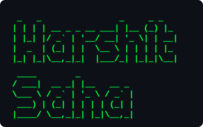

### Repos

[kernix](https://github.com/hsxtheemperor/kernix) · [micro-kernix](https://github.com/hsxtheemperor/micro-kernix) · [NoteBooks-Framework](YOUR-FSR-OFFICIAL-LINK)

### Stack

Also: Cython, Assembly, Make

### Contact

[LinkedIn](https://www.linkedin.com/in/harshit-saha/) · [Email](mailto:hsxtheemperor@gmail.com)
